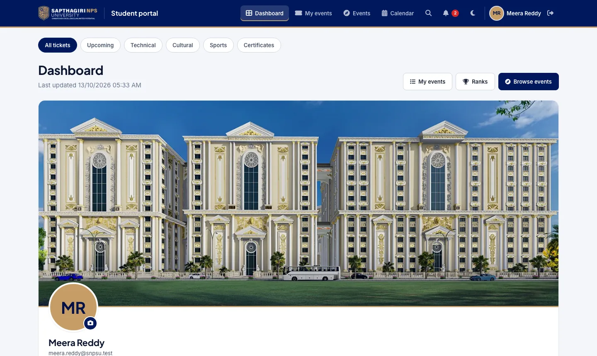
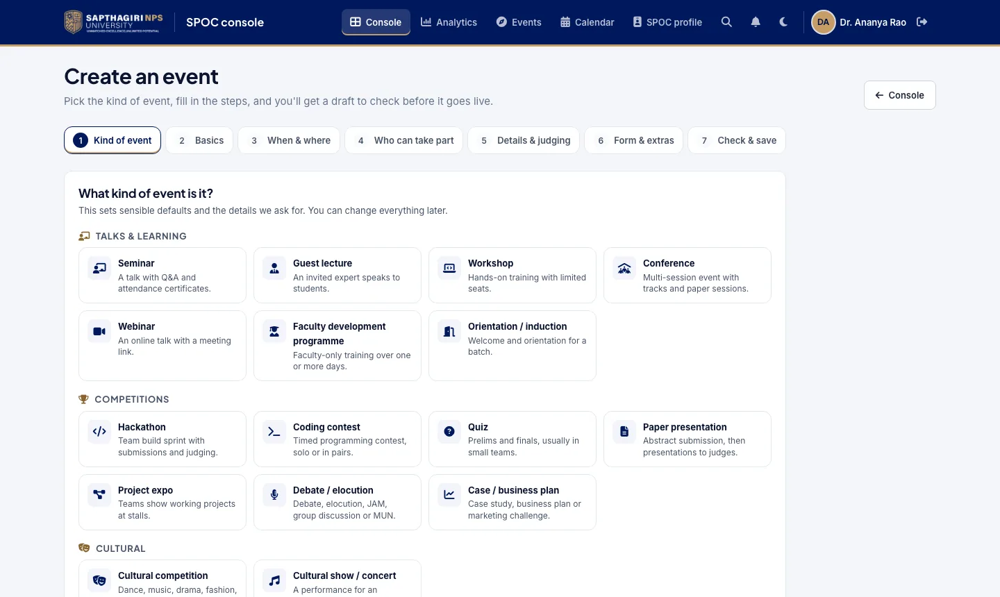
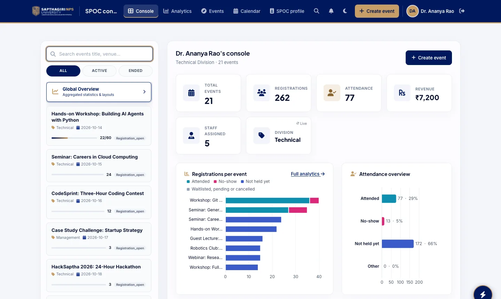
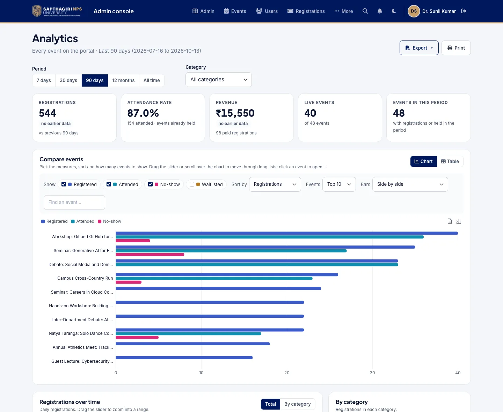
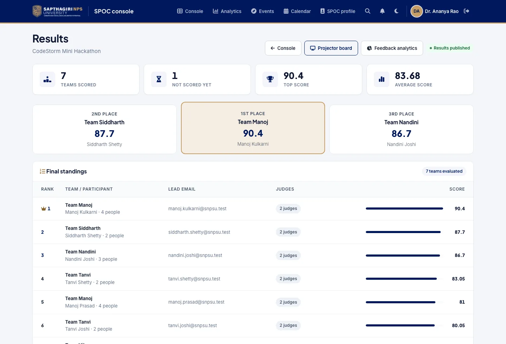
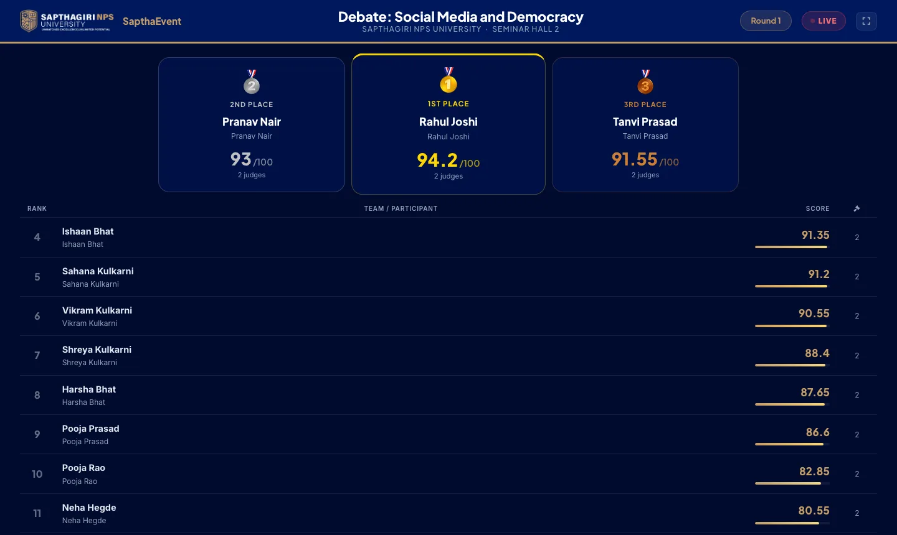
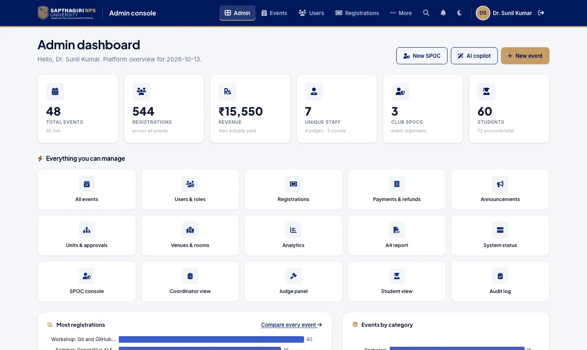

<div align="center">


<br/>

# SapthaEvent

**The event portal of Sapthagiri NPS University, Bengaluru**

*Every campus event. One place to join in.*

<br/>

<a href="https://saptha-967997581752.asia-south1.run.app"></a>
&nbsp;
<a href="#run-it-locally"></a>

<sub>Live on Google Cloud Run (Mumbai) · <a href="https://saptha-967997581752.asia-south1.run.app">saptha-967997581752.asia-south1.run.app</a></sub>

<br/>
<br/>


<br/>

[Live demo](#live-demo) · [About](#about) · [Screenshots](#screenshots) · [Roles](#who-it-is-for) · [Features](#features) · [Run it locally](#run-it-locally) · [Technology](#technology) · [Quality](#quality) · [Docs](#documentation)

</div>

<br/>

## Live demo

**[https://saptha-967997581752.asia-south1.run.app](https://saptha-967997581752.asia-south1.run.app)**

| | |
|:--|:--|
| 🌐 **Open it** | Browse events, register, or verify a certificate. No login needed to register; a registration made without logging in shows up on your dashboard once you log in. |
| 💳 **Payments** | Razorpay in **Test Mode**: pay with Razorpay's [test cards or test UPI](https://razorpay.com/docs/payments/payments/test-card-upi-details/). No real money moves. |
| ⏱️ **First visit** | The site sleeps when nobody is using it, so the first page can take about 10 seconds to wake it up. |
| 🩺 **Health** | [`/health/ready`](https://saptha-967997581752.asia-south1.run.app/health/ready) answers `{"ready": true}` when the app and its database are up. |

Hosted on Google Cloud: Cloud Run for the app, Cloud SQL (PostgreSQL 16) for the data, Secret Manager for
every secret, Cloud Storage for uploads and Cloud Scheduler for reminders. Accounts are created by the
university's Super Admin.

<br/>

## About

SapthaEvent brings every event at the university into one portal: hackathons and coding contests,
workshops and guest lectures, cultural competitions and shows, sports tournaments, placement drives and
multi-day fests with their own sub-events.

Students find an event, register in a minute and walk in with a QR ticket. Organisers create and publish
events, manage registrations, check people in, run judging and publish results, and issue certificates
that anyone can verify. The university sees all of it in one console, with analytics to match.

<br/>

## Screenshots

<table>
  <tr>
    <td width="50%" valign="top">
      
      <p align="center"><b>Home</b><br/><sub>The next events, live from the database, on the campus photograph</sub></p>
    </td>
    <td width="50%" valign="top">
      
      <p align="center"><b>Student dashboard</b><br/><sub>Tickets, upcoming events, results and certificates</sub></p>
    </td>
  </tr>
  <tr>
    <td width="50%" valign="top">
      
      <p align="center"><b>Create an event</b><br/><sub>A 7-step wizard for 27 kinds of event</sub></p>
    </td>
    <td width="50%" valign="top">
      
      <p align="center"><b>SPOC console</b><br/><sub>Registrations, attendance and revenue for every event</sub></p>
    </td>
  </tr>
  <tr>
    <td width="50%" valign="top">
      
      <p align="center"><b>Analytics</b><br/><sub>Compare every event, with filters, zoom and table views</sub></p>
    </td>
    <td width="50%" valign="top">
      
      <p align="center"><b>Results</b><br/><sub>Judges' scores ranked, with a podium and standings</sub></p>
    </td>
  </tr>
  <tr>
    <td width="50%" valign="top">
      
      <p align="center"><b>Live leaderboard</b><br/><sub>For the projector on the event day</sub></p>
    </td>
    <td width="50%" valign="top">
      
      <p align="center"><b>Admin console</b><br/><sub>Every event, account and registration in one place</sub></p>
    </td>
  </tr>
</table>

<br/>

## Who it is for

| | Role | What they can do |
|:-:|:--|:--|
| 🌐 | **Visitor** | Browse and search events, read event pages, learn about the university, verify a certificate |
| 🎓 | **Student** | Register alone or as a team, pay where needed, get a QR ticket, see results, download certificates, give feedback |
| 🧭 | **Club SPOC** | Create, review and publish events (fests included), build registration forms, appoint staff, book rooms, publish results, issue certificates, see analytics |
| 📋 | **Event coordinator** | Manage registrations and exports, check people in with the QR scanner, run rooms and rounds |
| ⚖️ | **Judge** | Score teams against the event's criteria and follow the live leaderboard |
| 🎟️ | **Volunteer** | Check people in at the gate |
| 🏛️ | **Super Admin** | Approve and manage every event, account and registration; venues, payments, announcements, analytics, system status and the audit log |

<br/>

## Features

<table>
  <tr>
    <td width="50%" valign="top">
      <h4>🗓️ Every kind of event</h4>
      Talks, competitions, cultural, sports, community, career, fests and custom events, each with its own
      details. Fees per participant group, team sizes, judging criteria, prizes, sponsors and room booking
      with clash checks. Every event is a draft until it is reviewed and published.
    </td>
    <td width="50%" valign="top">
      <h4>🎫 Registration and tickets</h4>
      A registration form per event, team members with their own details, waitlists, Razorpay payments with
      coupons and refunds, and a QR ticket the moment someone registers. Students can register without
      logging in; the account's email gets a "Not you? Cancel" link.
    </td>
  </tr>
  <tr>
    <td width="50%" valign="top">
      <h4>✅ The event day</h4>
      QR check-in, live attendance, rooms and rounds, and judges' scoring against the rubric.
    </td>
    <td width="50%" valign="top">
      <h4>🏆 One leaderboard</h4>
      The projector board, the live board, the judges' view, the results page and the published winners all
      use one ranking. Scores keep their decimals and equal scores share a place.
    </td>
  </tr>
  <tr>
    <td width="50%" valign="top">
      <h4>📜 Verifiable certificates</h4>
      Issued to everyone who attended, each with a verification link and QR code.
    </td>
    <td width="50%" valign="top">
      <h4>📊 Analytics</h4>
      Compare every event side by side, registrations over time, a weekday × hour heatmap, the funnel from
      registration to certificate, revenue and no-shows, filtered by period and category.
    </td>
  </tr>
  <tr>
    <td width="50%" valign="top">
      <h4>🔔 Notifications</h4>
      Email, WhatsApp and in-app notifications, and announcements to any group of people.
    </td>
    <td width="50%" valign="top">
      <h4>♿ Built for everyone</h4>
      Mobile-first, dark mode, keyboard and screen-reader friendly, installable as an app, in English,
      Hindi and Kannada.
    </td>
  </tr>
  <tr>
    <td colspan="2" valign="top">
      <h4>🔒 Secure by default</h4>
      Permission checks on every route, CSRF protection, a strict Content Security Policy, rate-limited
      login, hashed passwords, and a refusal to start in production without real secrets. A payment counts
      only when Razorpay confirms it: the amount is set on the server, every signature is checked, and a
      signed webhook completes payments whose browser closed, handles refunds, and never counts a payment twice.
    </td>
  </tr>
</table>

<br/>

## Run it locally

You need Python 3.11. SQLite is used automatically in development, so no database set-up is needed.

```bash
git clone https://github.com/kirancodes-dev/saptha-event-portal.git
cd saptha-event-portal
python3.11 -m venv .venv && source .venv/bin/activate
pip install -r requirements-dev.txt
cp .env.example .env          # then fill in what you need (mail, Razorpay test keys)
python app.py                 # http://localhost:5001
```

Run the tests and the linter:

```bash
python -m pytest -o addopts="" -q
ruff check .
```

To try payments, put Razorpay **test** keys in `.env` (`RAZORPAY_KEY_ID=rzp_test_…`, `RAZORPAY_KEY_SECRET`,
`RAZORPAY_WEBHOOK_SECRET`). Never commit `.env`; `.env.example` explains every setting.

<br/>

## Technology

<table>
  <tr><td><b>Application</b></td><td>Flask 3, Jinja, Bootstrap 5 and a shared design system in the university's navy and gold</td></tr>
  <tr><td><b>Data</b></td><td>SQLAlchemy 2 on PostgreSQL (SQLite for development), Alembic migrations</td></tr>
  <tr><td><b>Background work</b></td><td>Celery, with an outbox that retries anything that failed to send</td></tr>
  <tr><td><b>Charts</b></td><td>Apache ECharts, with colour-blind-safe palettes in light and dark mode</td></tr>
  <tr><td><b>Documents</b></td><td>ReportLab certificates with QR verification, Excel exports with openpyxl</td></tr>
  <tr><td><b>Payments</b></td><td>Razorpay Orders, Checkout and signed webhooks (one merchant account)</td></tr>
  <tr><td><b>Messages</b></td><td>Email, WhatsApp (Twilio) and web push</td></tr>
  <tr><td><b>AI (optional)</b></td><td>Google Gemini for the event writer, the form generator and report summaries</td></tr>
  <tr><td><b>Security</b></td><td>Flask-Talisman, Flask-WTF, Flask-Limiter, server-side sessions</td></tr>
  <tr><td><b>Deployment</b></td><td>Google Cloud Run, Cloud SQL (PostgreSQL 16), Secret Manager, Cloud Storage and Cloud Scheduler; Docker and Docker Compose anywhere else</td></tr>
</table>

<br/>

## Quality

The project has **973 automated tests**, run on the real database layer. In the full run on
17 October 2026, **967 pass** and 1 is skipped. The 5 that fail are known
and tracked in the feature review, not hidden: two tests for a payment provider that was removed (Stripe)
and three for the matchmaker feature that was hidden. Whether to retire them is an open decision (D-9).

Every change is also checked with `ruff`, and the editor's type checker (Pyrefly) is configured in
`pyrefly.toml`.

<br/>

## Documentation

| Document | What it covers |
|:--|:--|
| [`docs/FEATURE_REVIEW.md`](docs/FEATURE_REVIEW.md) | Every feature, what is done, what is open and why |
| [`docs/DEPLOY.md`](docs/DEPLOY.md) | Deploying to production (migrations, scheduled jobs, backups) |
| [`docs/API.md`](docs/API.md) | The REST API |
| [`docs/ARCHITECTURE.md`](docs/ARCHITECTURE.md) | How the parts fit together |
| [`docs/SECURITY.md`](docs/SECURITY.md) | The security model |

<br/>

## License

MIT License

Copyright (c) 2026 Sapthagiri NPS University

Permission is hereby granted, free of charge, to any person obtaining a copy
of this software and associated documentation files (the "Software"), to deal
in the Software without restriction, including without limitation the rights
to use, copy, modify, merge, publish, distribute, sublicense, and/or sell
copies of the Software, and to permit persons to whom the Software is
furnished to do so, subject to the following conditions:

The above copyright notice and this permission notice shall be included in all
copies or substantial portions of the Software.

<br/>

<div align="center">


<sub>Sapthagiri NPS University · #14/5, Chikkasandra, Hesarghatta Main Road, Bengaluru 560057 · <a href="https://snpsu.edu.in">snpsu.edu.in</a></sub>

</div>
